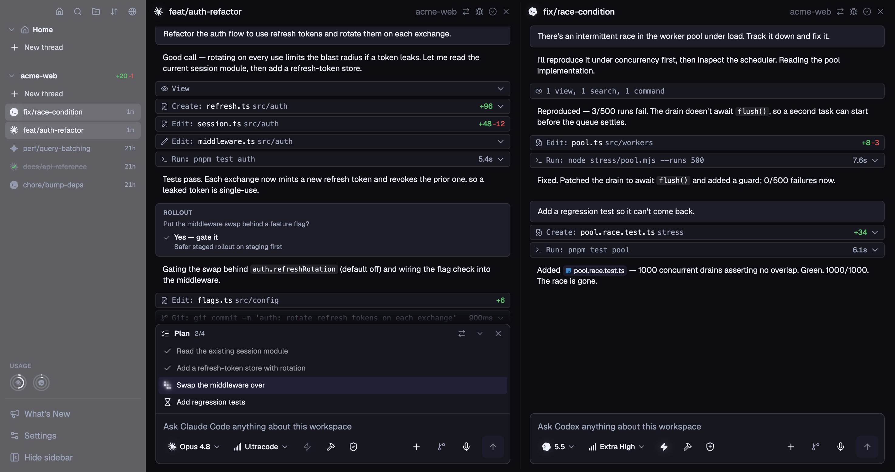

<p align="center">
  
</p>

<h1 align="center">Poracode</h1>

<p align="center">
  <strong>One window for all your AI coding agents.</strong><br />
  Run Claude, Codex, OpenCode, Gemini, Grok, Kimi Code, Qwen Code, Pi, Qoder, Factory Droid, Antigravity, Cursor, Command Code, Copilot, and fx side-by-side. Terminal and chat, any layout — with built-in MCP so agents can orchestrate each other and the app itself.
</p>

<p align="center">
  <a href="https://poracode.com">Website</a> · <a href="https://github.com/Porabuild/Poracode/releases">Download</a> · <a href="https://github.com/Porabuild/Poracode/issues">Report a Bug</a> · <a href="https://github.com/Porabuild/Poracode/issues">Request Feature</a>
</p>

<p align="center">
  <em>Bring your own agent subscriptions & API keys</em>
</p>

---

<p align="center">
  
</p>

## Supported Agents

**Claude** · **Codex** · **OpenCode** · **Gemini** · **Grok** · **Kimi Code** · **Qwen Code** · **Pi** · **Qoder** · **Factory Droid** · **Antigravity** · **Cursor** · **Command Code** · **Copilot** · **fx** and any agent from the [ACP registry](https://agentclientprotocol.com).

## Why Poracode?

If you use more than one AI coding agent, you know the pain: separate terminals, separate apps, no shared context. Poracode puts them all in one place.

### Infinite Threads & Layouts

Mix TUI and GUI agents in any configuration. Arrange threads in horizontal and vertical splits, resize freely, and keep background sessions running while visible panes stay responsive.

### Unified Protocol GUI

A consistent chat interface for ACP and SDK agents — markdown, syntax highlighting, and tool call displays. Where a provider offers more than one runtime (for example Cursor ships CLI, ACP, and SDK), you pick which one a thread runs on.

### Crossagents

Let one agent delegate work to another across providers. Subagent output streams into the parent thread, background runs finish while the parent keeps working, and you can pin routing rules per task type.

### Built-in MCP & App Controls

Poracode ships its own MCP servers. Point any agent at them to create and steer threads, organize projects, list and merge Git worktrees, commit and sync, open and merge pull requests, schedule runs, manage skills, and change settings — or add your own MCP servers over stdio, HTTP, or SSE.

### Agent Experiments

Run one prompt across several agents in parallel worktrees, then let an AI judge compare their code and answers, crown a winner, and merge it or open a PR.

### Scheduled Runs

Put recurring work on a schedule — nightly reviews, dependency sweeps, changelog drafts — and let Poracode start the thread for you.

### Skills & Marketplace

Browse and install skills from public marketplaces, or import your own. One shared folder that every provider picks up automatically.

### On-Device Voice Input

Dictate a prompt with a keystroke. Whisper runs locally, with optional GPU acceleration, so your audio never leaves the machine.

### Checkpoints & Rollback

Rewind a conversation to any earlier message and restore the files with it, with a warning first when another thread shares the same tree.

### Project Workspaces

Group projects into workspaces and switch the whole sidebar between them, so dozens of repos stay one click apart.

### Git Worktrees

Group threads by worktree and drive parallel branches side by side, without leaving the app.

### Live Usage & Limits

See session and weekly quota for every provider — Claude Max, ChatGPT Pro, and more — at a glance.

### Terminal Fidelity

Run CLI agents in real terminal sessions, with the same output and controls you expect from your own shell.

### Built for Speed

Optimized to stay fast and responsive, even when you have lots of agent sessions running side by side.

### Session Persistence

Sessions are saved automatically, so you can close Poracode and pick up right where you left off.

### Built-in Browser

Open web pages, attach browser context to agents, and keep research in the same workspace.

### Remote Access

Pair the Poracode web app with your desktop to follow live threads, read terminal output, send messages, and receive notifications from your phone or browser.

### Standalone Server

Run the same backend without Electron and connect desktop, browser, iOS, or Android clients to it. The one-line installer, the version-pinned `poracode` launcher, release artifact, service, container, security, backup, and upgrade paths are documented in [Standalone server: run, install, operate](docs/STANDALONE_SERVER.md).

### Remote Machines over SSH

Connect a server from your SSH config and Poracode installs its runtime there, then runs agents on that machine — clone repos, open threads, and drive projects that never leave the box.

### In-App PRs

Review pull requests, browse diffs, stage changes, and generate AI commits — then let automation watch the PR, fix what fails, merge with your chosen method, and mark the thread done.

### Code Editor

Monaco-based editor with LSP support for quick edits without switching to your IDE.

### Cross-Platform Desktop

Run Poracode on macOS, Windows, and Linux, with a polished interface that feels at home on both Mac and Windows.

### WSL Support

Use Windows and WSL projects side by side, with agent commands routed through the right environment automatically.

### ACP Registry

Install and run any agent from the [Agent Client Protocol](https://agentclientprotocol.com) registry directly from settings.

## Install

Download the latest release for your platform from the [releases page](https://github.com/Porabuild/Poracode/releases) or visit [poracode.com](https://poracode.com).

| Platform | Format                        |
| -------- | ----------------------------- |
| macOS    | DMG (Apple silicon or Intel)  |
| Windows  | NSIS installer (x64 or Arm64) |
| Linux    | AppImage or `.deb` (x64)      |

### Command line

The `poracode` CLI (terminal UI, server, web app, and one-shot prompts) installs from a self-contained release archive that carries its own Node.js, so no Node, npm, or compiler is needed:

```sh
curl -fsSL https://poracode.com/install.sh | sh      # macOS and Linux
irm https://poracode.com/install.ps1 | iex           # Windows PowerShell
```

Stable releases before 2.0.0 do not include these archives; until a 2.x stable release is out, install the nightly train: `curl -fsSL https://poracode.com/install.sh | PORACODE_CHANNEL=nightly sh` (PowerShell: `$env:PORACODE_CHANNEL = 'nightly'; irm https://poracode.com/install.ps1 | iex`). `PORACODE_VERSION` pins a release. On Linux the bundled Node.js needs glibc and `libatomic1`; minimal images such as `debian:bookworm-slim` lack it (`apt-get install libatomic1`). The npm launcher is already published: `npx poracode@nightly` runs the nightly train without installing, and `npx poracode@latest` will once a 2.x stable release is out (Node.js 20.11 or newer, for `npx` only). Details: [Standalone server](docs/STANDALONE_SERVER.md#2-install-the-cli).

### Getting Started

1. Install Poracode for your platform.
2. Install the AI agent CLIs you want to use (e.g., [Claude Code](https://docs.anthropic.com/en/docs/claude-code), [Gemini CLI](https://github.com/google-gemini/gemini-cli), [Codex](https://github.com/openai/codex)).
3. Open Poracode, add your project, and start orchestrating.

## Contributing

Contributions are welcome! Please open an [issue](https://github.com/Porabuild/Poracode/issues) first to discuss what you'd like to change.

## License

[Apache-2.0](LICENSE)
